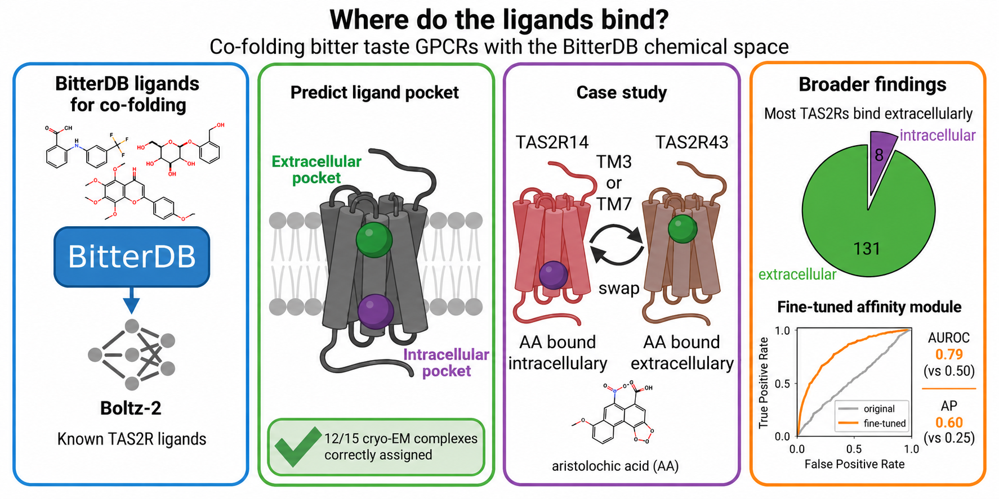

<div align="center">

[Preprint](https://www.biorxiv.org/content/10.64898/2026.06.26.734512v1) | [BitterDB](https://bitterdb.agri.huji.ac.il/dbbitter.php) | [NivTasteLab](https://www.nivtastelab.com)


</div>

## Overview

This repository contains the Python code and Jupyter notebooks required to reproduce the analyses and figures reported in the **Where do the ligands bind? Co-folding bitter taste GPCRs with the BitterDB chemical space** [preprint](https://www.biorxiv.org/content/10.64898/2026.06.26.734512v1).

Data, predictions and config files avaliable in [Zenodo repository](https://zenodo.org/records/21872900).

## Installation 
#### 1) Download the repository and install the TAS2Rs_cofolding environment
```text
git clone https://github.com/MashaLab/TAS2Rs_cofolding.git
cd TAS2Rs_cofolding

conda env create -f environment.yml
```
The TAS2Rs_cofolding environment is used to run all `notebooks` **except 08_Finetune_affinity_module.ipynb**
#### 2) Install the Boltz-2 environment
```text
conda env create -f environment-boltz.yml

conda run -n cofolding-boltz \
    python -m pip install -e "./external/boltz[cuda]"
```
The Boltz-2 environment is used to run the **08_Finetune_affinity_module.ipynb** notebook and all `predictions` using the generated `configs`
```text
boltz predict [path_to_config_directory] --out_dir [path_to_predictions] --diffusion_samples [samples_number] --output_format pdb --use_msa_server
```
You can find more information about using Boltz-2 in the [official repository](https://github.com/jwohlwend/boltz/tree/main).
#### 3) Download the data from Zenodo
```text
wget https://zenodo.org/records/21872900/files/TAS2Rs_cofolding_data.zip
```
To obtain the full dataset, which includes data, predictions, and configuration files for non-agonist TAS2Rs and for fine-tuning the affinity module, please contact the authors directly to request access (evgenii.ziaikin@mail.huji.ac.il, masha.niv@mail.huji.ac.il).

## Repository structure
After you install the necessary environments and download the data, the repository structure should be as follows:
```text
configs/     Configs used to run Boltz-2
data/        Input and processed files required by the notebooks
external/    External packages: rdkit and Boltz-2
figures/     Generated manuscript figures
notebooks/   Jupyter notebooks used to generate manuscript figures
predictions/ Boltz-2 predictions
src/         Reusable python code
```

## Jupyter notebooks description
| Notebook | Content | Manuscript Figures|
| --- | --- | --- |
| `01_Docked_TAS2R14_intracellular_binders.ipynb` | Docked intracellular agonists of TAS2R14 | Supplementary Figure 1A |
| `02_Cofolded_TAS2R_cryoEM_complexes.ipynb` | Co-folded TAS2R-agonist complexes solved by cryo-EM | Figure 1A|
| `03_Binding_pocket_replacement.ipynb` | Co-folded TAS2R14/TAS2R43-aristolochic acid complexes with a replaced extracellular/intracellular pocket | Figure 2D, Supplementary Figure 4 |
| `04_TM_replacement.ipynb` | Co-folded TAS2R14/TAS2R43-aristolochic acid complexes with a replaced TMs | Figure 2E, Supplementary Figure 3 |
| `05_Morphing_of_TAS2R14_into_TAS2R43.ipynb` | Co-folded TAS2R14-aristolochic acid complexes with step-by-step morphed TM3/TM7 | Figure 2F |
| `06_Predicted_intracellular_binding_of_TAS2R_agonists.ipynb` | Co-folded TAS2R-agonist complexes with predicted intracellular pocket | Figure 3 |
| `07_Predicted_TAS2R_agonist_and_non-agonist_complexes.ipynb` | Co-folded TAS2R-ligand complexes with predicted affinity values | Figure 4, Supplementary Figure 5 |
| `08_Finetune_affinity_module.ipynb` | Code for fine-tuning the affinity module | |
| `09_Finetune_results.ipynb` | Results of fine-tuning the affinity module | Figure 5, Supplementary Figure 6, Supplementary Figure 7 |

## Citation
If you use this code in your research, please cite:
> Evgenii Ziaikin, Masha Y. Niv, Where do the ligands bind? Co-folding bitter taste GPCRs with the BitterDB chemical space, bioRxiv, 2026.